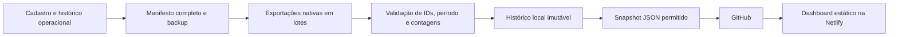

# Como criar e manter um dashboard de Reels

Manual em português para construir um dashboard como o Reels Studio e mantê-lo atualizado com exportações do Meta Business Suite, histórico local e deploy pelo GitHub.

Este repositório contém **instruções, exemplos fictícios e prompts**. Não contém o app operacional, dados de páginas reais nem o coletor privado. Um agente consegue usar este material como especificação para implementar um projeto independente.

## Comece por aqui

1. [Como construir o dashboard](docs/criacao.md).
2. [Modelo de dados e cálculos](docs/modelo_de_dados.md).
3. [Como coletar todas as páginas e atualizar](docs/atualizacao.md).
4. [Como diagnosticar problemas](docs/diagnostico.md).
5. [Prompt pronto para seu agente](prompts/agente.md).
6. [Manifesto fictício](exemplos/manifesto.json) e [snapshot fictício](exemplos/snapshot.json).

## O processo utilizado

A coleta usa a exportação consolidada da Meta. Selecionamos várias páginas no mesmo relatório em vez de abrir cada Reel e copiar seus números. Nas sessões de referência, o seletor permitiu até **50 páginas por exportação**. Para 60 páginas, usamos dois conjuntos disjuntos, de 50 e 10. Esse limite foi observado na interface e deve ser revalidado se ela mudar.

O agente seleciona as páginas pela interface autenticada, confere período, modo e fuso, solicita o relatório e aguarda a conclusão. Os CSVs são unidos por nome de coluna, validados contra o manifesto e importados como uma única rodada, preservando os brutos e o horário de cada lote. Isso é uma coleta consolidada, não uma leitura instantânea de todas as páginas.

O dashboard recebe só um JSON com os campos autorizados. Ele funciona mesmo com o computador de coleta desligado. O botão **Atualizar** do site recarrega o último arquivo publicado; uma nova coleta depende do agente e do navegador local ou de outra integração explicitamente implementada.

## O que reproduzir na interface

- Total de Reels publicados, views conhecidas, comentários e cobertura por métrica.
- Última coleta, agendamentos futuros e registros pendentes de conciliação separados.
- Filtros por página, áudio, período de publicação, estado e rotação.
- Comparação entre os mesmos vídeos em duas coletas.
- Destaques para páginas fora da rotação que continuam crescendo, concentração em um Reel e comentários por mil views.
- Tabela, cards, mapa por página, detalhe com histórico e CSV do recorte.
- Inventário de páginas por nicho planejado, inclusive páginas sem publicações acompanhadas.

Não usar quantidades, nomes ou políticas fixas de outro projeto. O cadastro atual da instalação e as decisões do proprietário governam esses campos.

## Publicação e atualização

A arquitetura recomendada tem coleta/importação local e site estático. O projeto implementado deve produzir `public/index.html`, arquivos de interface e `public/data.json`. Na Netlify, conecte o repositório de **seu aplicativo**, branch de produção, diretório `public` e sem comando de build se os arquivos finais já estiverem commitados.

Este repo de instruções não deve ser apontado como se fosse o app. Para deploy automático, o push precisa ocorrer no repo que contém o bundle do dashboard.

## Critério de conclusão

Uma atualização termina quando o relatório foi validado, o histórico foi preservado, o snapshot passou nos verificadores, o push terminou e a URL ao vivo exibe os dados novos. Commit e site devem servir os mesmos bytes de dados/interface. Se a Meta omitir registros, publicar somente valores comprovados e informar a cobertura parcial.
